# 慢信（Manxin）— 第 3～5 節

> 「從前慢，如今也慢。」一個模擬寫信、走去郵局寄信、等信送達、親手拆信的網頁 App。

---

## 3. 系統架構與前後端設計

### 3.1 系統架構圖

```
 ┌──────────────────────── 瀏覽器 ────────────────────────┐
 │  前端 apps/web（React + TypeScript，Vite 打包）          │
 │  書桌 / 郵局地圖 / 櫃台 / 追蹤 / 收信 / 收藏 / 字紙冢     │
 │  畫面用 DOM + CSS 動畫；四種年代風格                     │
 │  api/client.ts：唯一對後端講話的地方（fetch + cookie）   │
 └───────────────▲──────────────────────────┬─────────────┘
                 │ JSON 回應                 │ REST + JSON（/api/*）
                 │                           ▼  cookie: mx_session
 ┌───────────────┴───────── 後端 apps/api（Fastify + TS） ─┐
 │ routes/   auth  desk  post  shipments  receive  ...     │
 │   │  JSON Schema 驗證輸入（多餘欄位直接 400）            │
 │   ▼                                                     │
 │ services/ letters  counter  shipments  receive  fonts…  │
 │   │            │                     │                  │
 │   │            ▼                     ▼                  │
 │   │   packages/engine（物流時間引擎，純函式）            │
 │   │   發車班次、上下班、國定假日、天氣延遲、送達時間      │
 │   ▼                                                     │
 │ drizzle-orm ──► PostgreSQL 16（開發可換 PGlite 記憶體版）│
 │                    ▲                                    │
 │ worker（每 30 秒）──┘ 掃 scheduled_jobs：送達通知、       │
 │                       24h/48h 提醒、30 天退信、30 天詢問 │
 │   │                                                     │
 │   ▼ Mailer 介面 ──► 開發：存進 dev_outbox（本機信箱頁）  │
 │                     正式：待寄表 → Gmail SMTP            │
 └─────────────────────────────────────────────────────────┘
        packages/shared：前後端共用的資料型別（DTO）
```

專案是 npm workspaces 的 monorepo：

| 資料夾 | 內容 |
|---|---|
| `apps/web` | 前端 |
| `apps/api` | 後端 API、資料庫 schema 與 migration、排程 worker |
| `packages/engine` | 物流時間引擎（不碰資料庫、不碰網路，可完整單元測試） |
| `packages/shared` | 前後端共用的 TypeScript 型別 |
| `prototype/index.html` | 最早的單檔原型（資料只存在瀏覽器），畫面與互動以它為藍本 |

**部署**：正式環境跑在自架的 Kubernetes（可用 KubeSphere 管理）。一個映像檔分成三種程序：API（同時提供前端網頁，API 在 `/api` 底下）、排程 worker、資料庫遷移；PostgreSQL 16 也在叢集裡，每天備份，另有腳本把備份拉到管理者自己的電腦。設定在 repo 的 `deploy/`。

### 3.2 前端與後端各自負責什麼

**前端（apps/web）負責「手感」：**
- 畫面與互動：打字機（鍵盤輸入／拼音鍵盤）、手寫（壓感筆畫）、改錯痕跡（劃線、打叉、塗黑、修正帶）、郵局地圖與路程倒數、櫃台徒手摺信、拖曳貼郵票與蓋郵戳、把信封拖進郵筒、收件人用開信刀或手撕拆信。
- 四種年代風格（八〇年代、民國初年、手繪塗鴉、藏寶圖）、三種書桌；偏好跟著帳號走，換裝置也一樣。
- 擋掉所有「後悔」的操作：退格、Ctrl+Z、複製、貼上、拖放都沒有作用。
- 前端**不自己判斷**時間與規則，只畫出後端回來的結果。

**後端（apps/api）負責「規則與真相」：**
- 帳號：email 登入連結（magic link）、session cookie。
- 書寫內容**只能追加**：API 只有「追加字元／追加標記／追加筆畫」，沒有修改或刪除；資料庫再用觸發器擋一次 UPDATE／DELETE。
- 時間判定：走到郵局要多久、能不能走進去，都用伺服器時間（改電腦時間沒用）。
- 櫃台規則：信紙摺完塞不塞得進信封（依信封內徑計算）、郵票郵戳只能貼一次、寄出前條件檢查。
- 物流：產生單號（UPU S10 格式含檢查碼）、用時間引擎算送達計畫與事件（發車班次、週末與國定假日不發車、天氣延遲、下班時間順延）。
- 排程：送達時寄開信通知給收件人；24／48 小時沒簽收提醒寄件人；30 天退信；放在抽屜的信每 30 天問一次要不要寄。
- 檔案：附件、信紙圖樣、自訂字型的上傳與權限控管；只收依檔頭判斷的真圖片，存進資料庫。
- 防騷擾：每人每天最多寄 5 封、同一個收件人 1 封；收件人可以封鎖、檢舉；管理員可以停權（看不到信件內容）。
- 安全：登入信、開信連結等端點有頻率限制；擋掉從別的網站送來的請求；log 不留登入與開信連結。

### 3.3 前後端如何交換資料

- **REST API + JSON**。前端所有請求都經過 `apps/web/src/api/client.ts`，加 `/api` 前綴；開發時 Vite proxy 把 `/api/*` 轉給 `127.0.0.1:3000`。
- **身分**：登入後後端設 `mx_session` cookie（httpOnly、SameSite=Lax），之後的請求自動帶上。收件人不需要帳號，用信裡的**開信連結 token**（`/r/:token`）存取那一封信。
- **型別一致**：請求與回應的型別（`LetterDTO`、`SheetDTO`、`ShipmentDTO`…）定義在 `packages/shared`，前後端 import 同一份，改欄位時兩邊一起被 TypeScript 檢查。
- **錯誤格式統一**：`{ error: { code, message, details } }`，例如 `NOT_ARRIVED`（還沒走到郵局）、`TOO_LONG`（信紙太長塞不進信封）。前端依 `code` 顯示對應的提示。
- **防止重複與衝突**：每個書寫操作帶 `opId`（UUID）、`seq`（目前第幾筆）、`sheetId`（哪一張紙）。網路斷掉重送不會寫兩次；兩個分頁同時寫會得到 409 `SEQ_CONFLICT`，不會互相蓋掉。

### 3.4 使用的框架、語言及主要套件

| 層 | 語言／框架 | 主要套件 |
|---|---|---|
| 前端 | TypeScript、React 19、Vite 8 | react-router 8；拼音詞組資料用 pinyin-pro 產生 |
| 後端 | TypeScript、Node.js 24、Fastify 5 | @fastify/cookie、@fastify/multipart、@fastify/static、drizzle-orm（ORM）、pg、nodemailer（Gmail SMTP）、pino（log）；esbuild 打包 |
| 資料庫 | PostgreSQL 16（Docker） | 沒有 Docker 時用 @electric-sql/pglite（記憶體版 PostgreSQL） |
| 測試 | — | Vitest（單元／API）、Testing Library（元件）、Playwright（端到端，真的開瀏覽器） |
| 共用 | — | npm workspaces、tsx、concurrently |
| 部署 | Docker、Kubernetes | 一個映像檔；Kubernetes 設定（kustomize）、ingress-nginx、cert-manager（選用）、pgAdmin（只從叢集內部連） |

### 3.5 資料從使用者操作流向後端，再回到畫面（以「打一個字」和「寄出」為例）

**例一：在打字機上打一個字**
1. 使用者按下鍵盤 → 前端書桌元件攔下按鍵（退格、Ctrl+Z 直接忽略）。
2. 前端呼叫 `POST /api/letters/:id/sheet/chars`，body `{ text: "慢", seq: 12, sheetId, opId }`。
3. 後端依序檢查：信是不是還能寫 → 是不是同一張紙 → `opId` 是否已寫過 → `seq` 對不對 → 這張紙還有沒有空位。
4. 通過後在 `sheet_ops` 新增一筆紀錄（只 INSERT），重算整張信紙，回傳新的 `SheetDTO`。
5. 前端用回應更新信紙，字出現在紙上。

**例二：投進郵筒到收件人拆信**
1. 使用者在櫃台把信封拖進郵筒 → `POST /api/letters/:id/post`。
2. 後端檢查寄出條件（地址、已裝信、已封口、已貼郵票），建立 `shipments`（單號、信封快照、送達計畫），並在 `scheduled_jobs` 排入送達、24h、48h、30 天四件事。回傳 `ShipmentDTO`，前端播寄信過場後跳到追蹤頁。
3. 追蹤頁 `GET /api/shipments/:no` 只顯示「已經發生」的物流事件。
4. 到了送達時間，worker 產生開信連結並寄通知給收件人。
5. 收件人點連結 → `GET /api/r/:token` 看到信封 → `POST /r/:token/open`（拆開即簽收）→ `pour`（倒出來）→ `unfold`（攤開後回應裡才有信的內容）。
6. 寄件人的追蹤頁變成「已簽收」，24h／48h 提醒和退信因為已簽收而自動略過。

---

## 4. 資料庫與 API 設計

### 4.1 資料表設計（PostgreSQL，定義在 `apps/api/src/db/schema.ts`）

共 23 張表，依用途分組：

| 分組 | 資料表 | 用途與重要欄位 |
|---|---|---|
| 帳號 | `users` | `id`、`email`（唯一）、`suspended_at`（停權）、`deleted_at`（刪除帳號後匿名化） |
| | `user_prefs` | 個人偏好（年代風格、書桌…），跟著帳號走 |
| | `login_tokens` | 登入連結（只存雜湊）、到期時間、是否用過 |
| | `sessions` | session（只存雜湊）→ `user_id` |
| 寫信 | `letters` | 一封信：`user_id`、`status`（drafting 書桌上／shelved 先放著／sent 已寄出）、`env`（地址，JSON）、`shelved_at`、`sent_at` |
| | `sheets` | 一張信紙：`letter_id`、`role`（current 正在寫／ref 謄抄後的舊紙／tomb 字紙冢）、`kind`（信紙／明信片）、`style`、`mode`（打字／手寫）、`font` |
| | `sheet_ops` | **信紙內容的追加紀錄**：主鍵 (`sheet_id`, `seq`)、`op`（JSON：一段字、一個標記或一筆筆畫）、`op_id`（防重送，唯一） |
| | `attachments`、`fonts` | 上傳的圖片（附件、信紙圖樣、自訂郵票…）與自訂字型 |
| 郵局 | `trips` | 前往郵局：地點、交通方式、`start_at`、`arrive_at`（伺服器算）；同一封信同時只能有一趟（部分唯一索引） |
| | `counters` | 櫃台狀態：信封、郵票、郵戳位置、摺痕、是否已裝入／封口 |
| | `envelope_ops` | 信封上寫的字（同樣只能追加；`op_id` 防重送） |
| | `counter_ops` | 摺信的操作 id（連點、重送不會多摺一次） |
| 物流 | `shipments` | 寄出的信：`no`（單號，唯一）、`letter_id`（唯一，一封信只寄一次）、`env`／`pkg`（寄出當下的地址與信封快照）、`plan`（送達計畫）、`deliver_at`、`signed_at`、`returned_at`、`recipient_token_hash`（開信連結） |
| | `email_edits` | 寄件人改收件信箱的紀錄（最多 2 次） |
| 收信 | `collection_items` | 收藏：收到的信、撬下來的郵票與火漆，屬於**收件信箱**（`recipient_email`） |
| 防騷擾 | `blocks` | 收件信箱封鎖了哪個寄件人 |
| | `reports` | 檢舉：原因、檢舉人寫的說明、處理狀態（不存信件內容） |
| 系統 | `scheduled_jobs` | 排程：`kind`、`unique_key`（唯一，重排不重複）、`run_at`、`status`、`attempts` |
| | `email_outbox` | 正式環境的待寄信件：交易成功後才用 Gmail 寄出，寄出後清掉內文 |
| | `blobs` | 上傳的檔案內容（多個 API 副本共用、跟著資料庫備份） |
| | `rate_limits` | 頻率限制計數（多個 API 副本共用） |
| | `dev_outbox` | 開發用信箱：開發階段寄出的 email 都存在這裡 |

**資料之間的關係**

```
users 1─* letters 1─* sheets 1─* sheet_ops
  │          │ 1─0..1 counters 1─* envelope_ops
  │          │ 1─*    trips
  │          │ 1─*    attachments
  │          └ 1─0..1 shipments 1─* email_edits
  │                       └ 1─*  collection_items（以收件 email 歸屬）
  └ 1─* fonts、sessions、user_prefs
shipments 1─* reports；blocks 以收件 email ＋ 寄件人 user_id 配對
scheduled_jobs 以 ref_id 指向 shipment 或 letter
```

**設計重點**
- **為什麼信紙內容拆成 `sheet_ops`，而不是一個文字欄位？** 產品核心是「落子無悔」：寫下去就改不掉。把每次書寫存成一筆只能新增的紀錄，信紙畫面是把所有紀錄依 `seq` 重放出來。資料庫觸發器擋下 `sheet_ops` 的 UPDATE、單獨 DELETE，以及信寄出後的任何新增——就算有人繞過前端直接呼叫 API 或改資料庫，也改不了已寫的字。
- **寄出時存快照**：`shipments.env`、`pkg` 存寄出當下的地址與信封樣子，之後帳號資料怎麼變，收件人看到的都是當時寄出的樣子。
- **信紙快照**：每 50 筆書寫存一次重放結果，之後只重放快照之後的部分，寫很多字也不會越來越慢。
- **排程用資料表而不是記憶體計時器**：伺服器重開不會漏；`unique_key` 唯一保證同一件事只排一次；worker 用 `FOR UPDATE SKIP LOCKED` 認領，開多個 worker 也不會重複寄信。

### 4.2 主要 API

完整規格見 `docs/api.md`（共 10 大類：帳號、時間地點、書桌、前往郵局、櫃台、物流、收信、收藏、排程、開發用）。以下列出最核心的 6 組：

**① 追加文字 `POST /letters/:id/sheet/chars`**（需登入）
- 用途：在打字機模式的信紙上寫字。這是「落子無悔」的關鍵：系統裡沒有任何修改或刪除內容的 API。
- 輸入：`{ "text": "好久不見", "seq": 12, "sheetId": "…", "opId": "…uuid…" }`
- 輸出：201 `SheetDTO`（整張信紙：`chars`、`cursor`、`seq`…）；同一個 `opId` 重送回 200 與目前的信紙。
- 錯誤：409 `LETTER_LOCKED`（信已出門或寄出）、409 `SEQ_CONFLICT`（別的分頁也寫了）、422 `INVALID_OP`（例如 `SHEET_FULL` 紙寫滿了）。

**② 出發去郵局 `POST /letters/:id/trip`、走進郵局 `POST /letters/:id/trip/enter`**（需登入）
- 用途：選郵局與交通方式出發；路程要真的等完，抵達時間由伺服器算。
- 輸入：`{ "place": "box" | "po" | "main", "mode": "walk" | "bike" | "car", "box": "green" | "red" }`
- 輸出：201 `TripDTO { place, mode, startAt, arriveAt }`；`enter` 成功回 `{ trip, counter }`。
- 錯誤：`enter` 在伺服器時間還沒到 `arriveAt` 時回 409 `NOT_ARRIVED`（`details` 附抵達時間與伺服器時間）。

**③ 把信放進信封 `POST /letters/:id/counter/insert`**（需登入、人在郵局裡）
- 用途：使用者徒手摺完信後裝進信封，伺服器依摺後的外框和信封內徑判斷裝不裝得下。
- 輸入：無（摺痕已經由 `POST /counter/folds { edge, at }` 一次次記錄）。
- 輸出：200 `CounterDTO`（`inserted: true`）。
- 錯誤：422 `TOO_WIDE`／`TOO_LONG`「塞不進去。信紙太長了，要再摺。」，`details` 附信紙寬高與信封內徑。

**④ 投進郵筒 `POST /letters/:id/post`**（需登入、人在郵局裡）
- 用途：正式寄出。建立單號、送達計畫與排程，信從此唯讀。
- 輸入：無。
- 輸出：201 `ShipmentDTO { no: "RR622666579TW", state: "transit", events, ... }`
- 錯誤：422 `NOT_READY`，`details.missing` 列出還缺什麼（`ADDRESS`、`INSERT`、`SEAL`、`STAMP`）。

**⑤ 物流追蹤 `GET /track/:no`**（公開）／`GET /shipments/:no`（寄件人）
- 用途：用單號查信走到哪裡。
- 輸入：路徑上的單號（會驗證 S10 檢查碼）。
- 輸出：`TrackDTO`：狀態（運送中／已送達未簽收／已簽收／已退回）、經過的站、**只列已經發生**的事件（發車、到處理中心、天氣延遲…）、送達時間；公開查詢時收件信箱遮成 `w***@example.org`。
- 錯誤：404（格式不對、檢查碼錯或查無單號）。

**⑥ 收件人拆信 `POST /r/:token/open`**（不需登入，靠開信連結）
- 用途：用開信刀或手撕打開信封，打開即簽收。
- 輸入：`{ "method": "knife" | "tear", "cutPath"?: [...] }`
- 輸出：`ReceiveDTO`（信封快照與收信狀態；手撕膠貼信封時伺服器擲骰決定有沒有毛邊並存檔）。信的內容要再經過 `pour`（倒出來）、`unfold`（攤開）才會出現在回應裡。
- 錯誤：404 `INVALID_TOKEN`（連結已因改信箱失效）、410 `GONE`（已退信）、409 `INVALID_STATE`（順序不對）。

---

## 5. 目前實作進度、成果與證據

### 5.1 已完成的功能

完整的寄信流程**已經可以從頭走到尾**，前後端都是真的資料流（PostgreSQL），不是假資料；正式版的容器也已經在本機整套跑過：

| 區塊 | 已完成 |
|---|---|
| 帳號 | email 登入連結（要按一下才登入，避免郵件掃描器用掉連結）、登出所有裝置、刪除帳號（寄出的信留給收件人）、偏好跟著帳號走 |
| 書桌 | 打字機（鍵盤輸入、拼音鍵盤）、手寫（鋼筆／原子筆／鉛筆）；5 種改錯痕跡；退格、復原、複製貼上全部無效；自選寫在哪一行；信紙、稿紙、八行箋（直書、剛好 8 行）、明信片；10 款內建信紙範本、上傳自訂圖樣與自訂字型；附件；謄抄成新紙、舊紙丟進字紙冢或垃圾桶；「先放著」抽屜 |
| 郵局 | 地圖選郵筒／郵局、走路／騎車／開車，路程倒數以伺服器時間為準 |
| 櫃台 | 選信封（郵政、牛皮紙、中式直式、米白方火漆 4 種＋自己上傳）、郵票、郵戳；確認地址；信封上寫字；徒手摺信、塞不進去要再摺；封口；拖曳貼郵票、蓋郵戳；拖進郵筒；寄信過場動畫 |
| 物流 | 單號、送達計畫（發車班次、週末與國定假日、上下班時間、天氣延遲）、追蹤頁與「送達時間怎麼算的」說明；改收件信箱（最多 2 次） |
| 收信 | 收件匣（用收件信箱登入就看得到）；開信連結（按「收下」才算點開，綁第一台動手的瀏覽器）；開信刀／手撕／易撕帶、撬郵票、撬火漆、撕毀與拼回碎片、倒出來、攤開、收進收藏 |
| 防騷擾 | 每人每天 5 封、同一收件人 1 封；收件人封鎖、檢舉；管理員停權 |
| 管理 | `/admin` 管理頁（使用者數、信件狀態、寄信與排程失敗可重試、檢舉處理），看不到信件內容 |
| 法遵 | 隱私權政策、使用條款 |
| 排程 | 送達通知、24h／48h 未簽收提醒、30 天退信（附退件郵戳）、抽屜裡的信 30 天詢問 |
| 風格 | 四種年代風格；民國風格寄信動畫用直式中式信封；系統設定「減少動態效果」時動畫全部跳過 |
| 部署 | Dockerfile、Kubernetes 設定、每日資料庫備份、備份拉回本機的腳本（實測可還原）、GitHub Actions 自動測試 |
| 開發工具 | 「快轉」讓伺服器時鐘往前走，不用真的等 7 天就能示範送達、提醒、退信 |

**自動化測試**（2026-11-12 在本機實際執行，`launch` 分支，從 main 的 `2593a90` 分出、尚未 commit 的工作目錄）：

| 測試 | 範圍 | 結果 |
|---|---|---|
| `npm run test:engine` | 物流時間引擎：發車、假日、天氣、送達計畫、摺信裝信、信紙格位；逐筆套用＝整張重放的隨機測試 | 7 個檔案、173 個測試全部通過 |
| `npm run test:api`（真的 PostgreSQL 16） | API：書寫只追加、防重送、多分頁衝突、郵局、櫃台、收信、排程、字型與範本、安全設定、頻率限制、收件匣、防騷擾、刪帳號、天氣；**多人同時操作**（同時寫字、同時投郵筒、三個 worker 同時跑排程） | 11 個檔案、128 個測試全部通過 |
| `npm run test:web` | 前端元件與工具函式 | 13 個檔案、141 個測試通過（最終驗證時有 1 次不明原因失敗，之後連續 10 次全過） |
| `npx playwright test` | 端到端，真的開瀏覽器：完整寄信收信流程（一般與「減少動態效果」兩種）；拼音鍵盤詞組；自選位置；明信片右半邊寫不進去；檢舉→管理員停權；帳號設定與隱私權政策；手機尺寸不橫向超出 | 7 個全部通過 |
| `docker compose -f deploy/docker-compose.prod.yml` | 正式版整套：遷移、API、worker、Gmail SMTP（用假郵件伺服器 Mailpit 接）、安全標頭、log 遮連結、備份與還原 | 手動驗證通過 |

### 5.2 尚未完成的功能

| 項目 | 現況 |
|---|---|
| 正式上線 | 程式與部署設定都完成，還沒部署到叢集，沒有公開網址（需要網域、映像檔倉庫） |
| 真的寄 Gmail | 寄信流程已經用假郵件伺服器驗證；還沒用真的 Gmail 帳號寄過（需要 Gmail 應用程式密碼） |
| 真實天氣 | 中央氣象署一週預報已接上，取不到就用模擬天氣；還沒用真的授權碼測過 |
| 真機測試 | 已用手機尺寸模擬檢查排版；還沒在真的手機、平板上測觸控手寫與動畫效能 |

### 5.3 執行畫面

以下截圖由 Playwright 腳本沿主流程實際操作後拍下（1–16：2026-11-09，本機，後端用 PGlite；17–19：2026-11-12）。畫面右上的「模擬時間」以民國紀年顯示，「快轉」用來跳過等待。

| 編號 | 畫面 | 檔案 |
|---|---|---|
| 1 | 首頁 |  |
| 2 | 登入（寄出登入連結） | 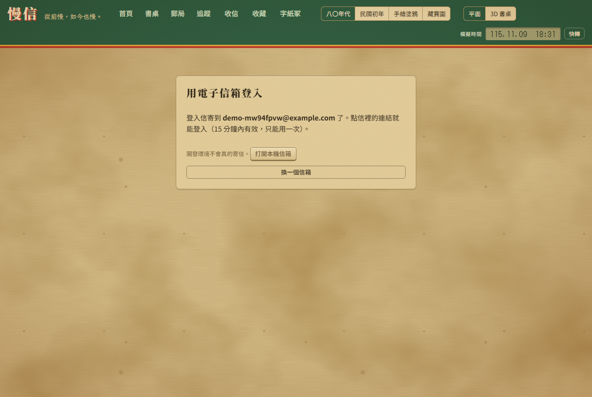 |
| 3 | 書桌：打字機寫信（平面） |  |
| 5 | 郵局地圖：選郵筒與交通方式 | 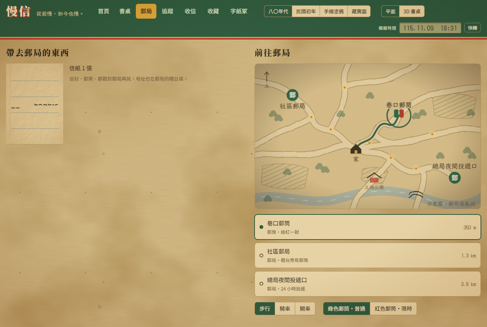 |
| 6 | 前往郵局：路程倒數 |  |
| 7 | 櫃台：填地址、選信封郵票郵戳 | 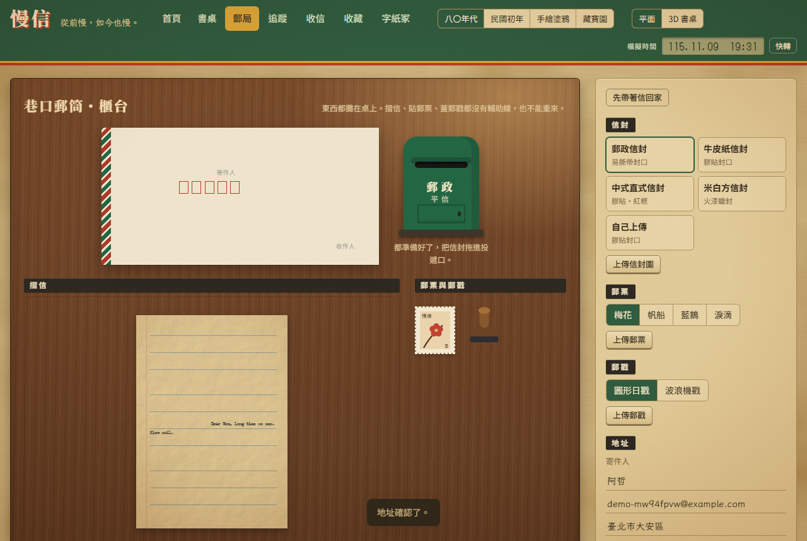 |
| 8 | 櫃台：摺好、裝好、封口、貼好郵票 | 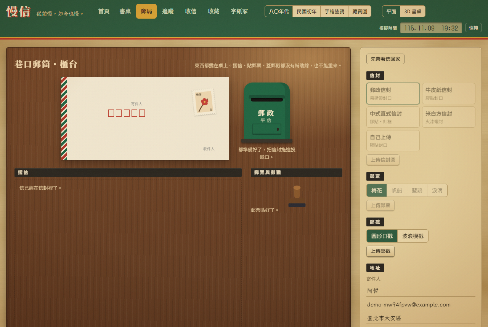 |
| 9 | 寄信過場：郵差收信 | 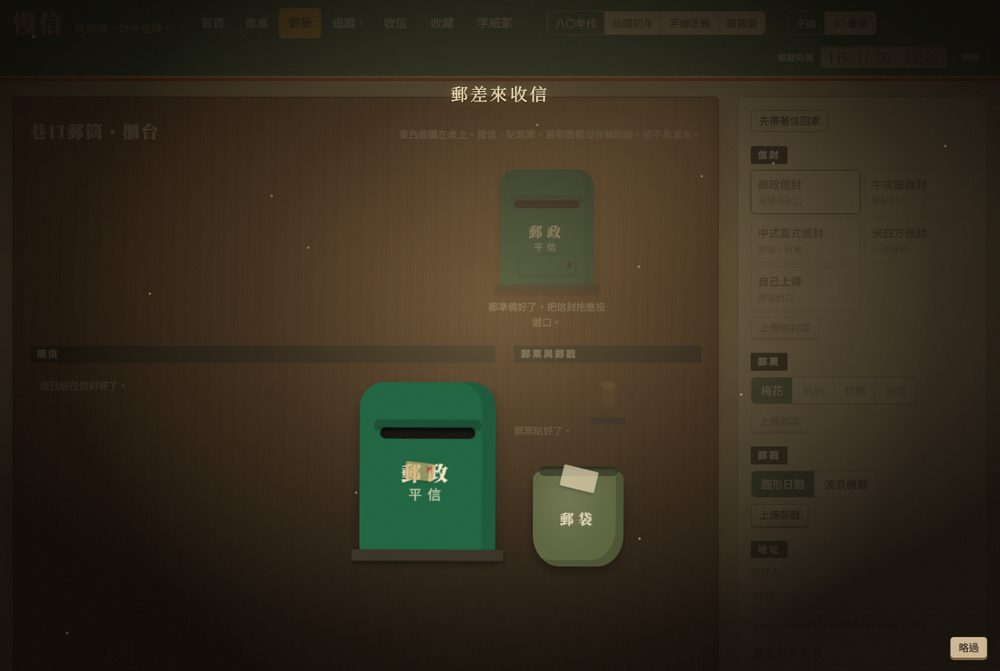 |
| 10 | 追蹤：運送中 | 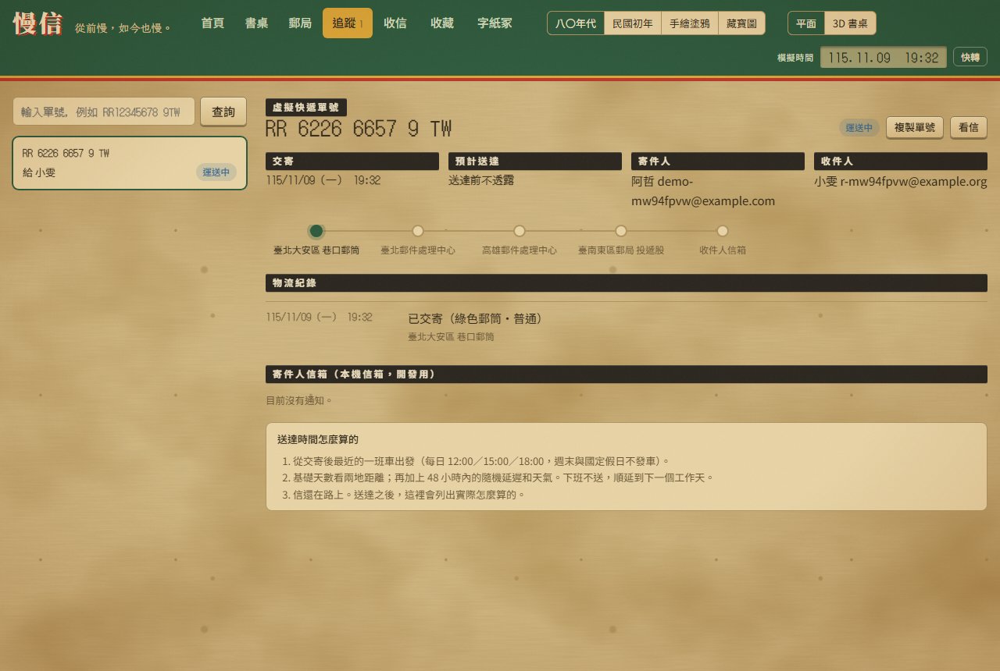 |
| 11 | 追蹤：已送達、物流紀錄（含天氣延遲）與送達時間計算說明 | 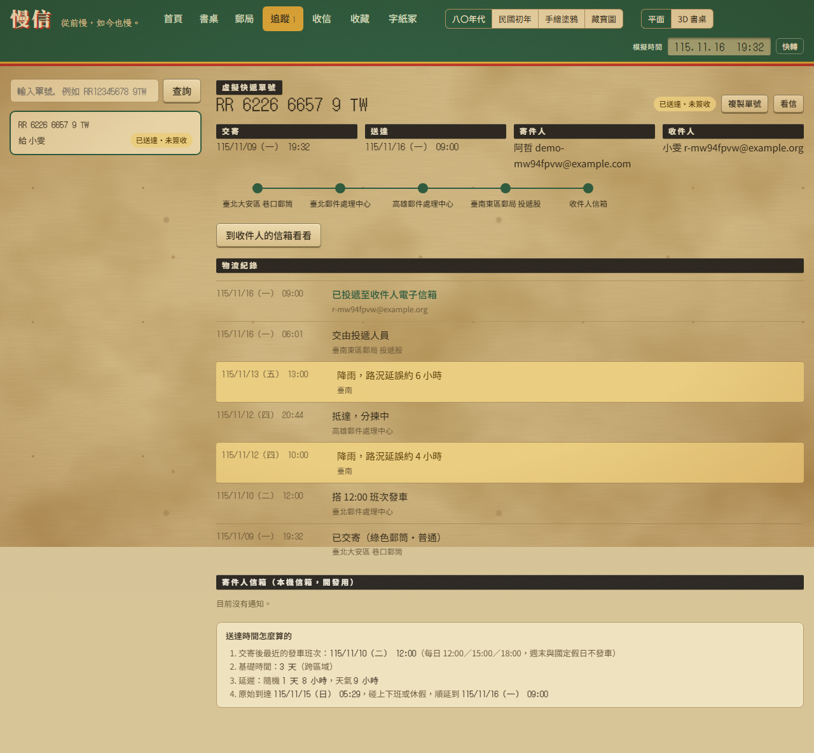 |
| 12 | 本機信箱（開發用，看系統寄出的 email） |  |
| 13 | 收件人：收到的信封 | 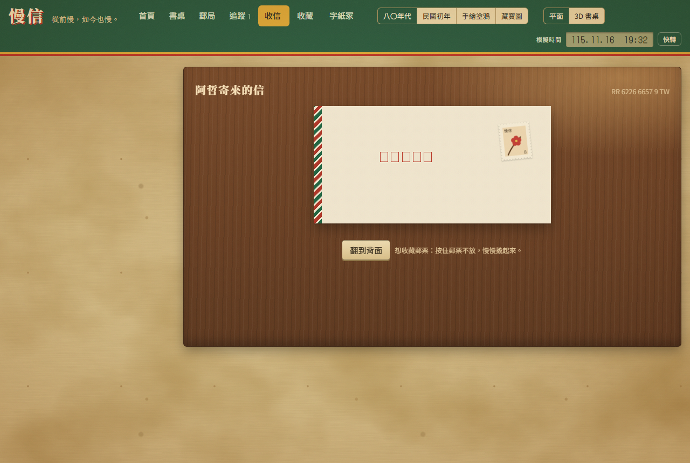 |
| 14 | 收件人：拆開、攤開的信（看得到兩道摺痕） | 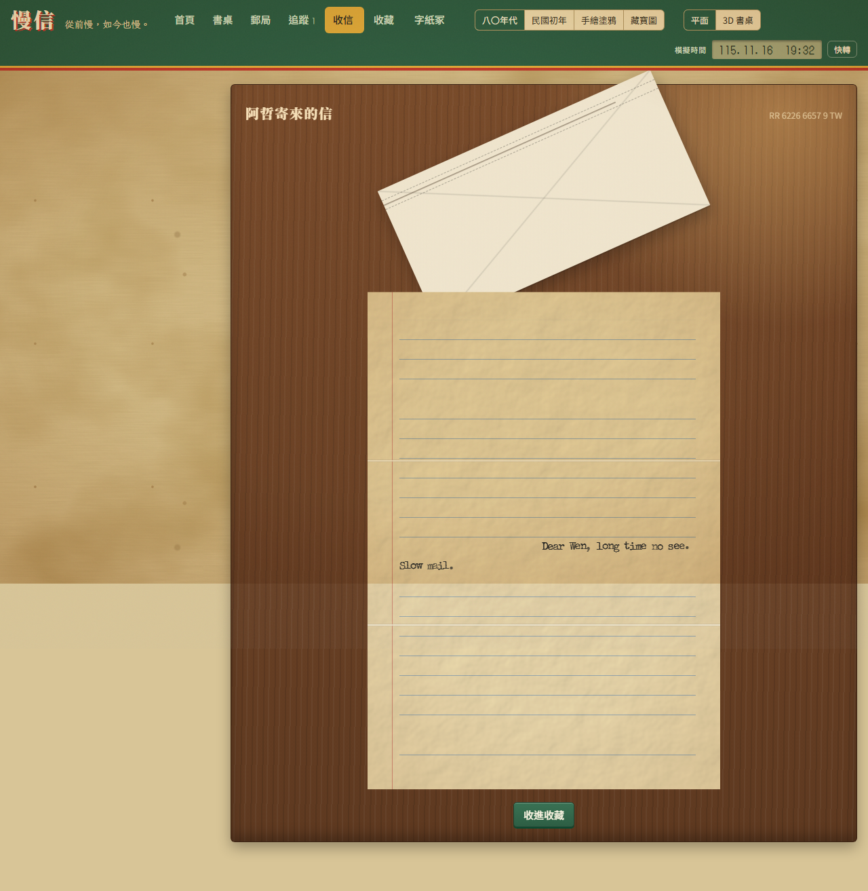 |
| 15 | 字紙冢 | 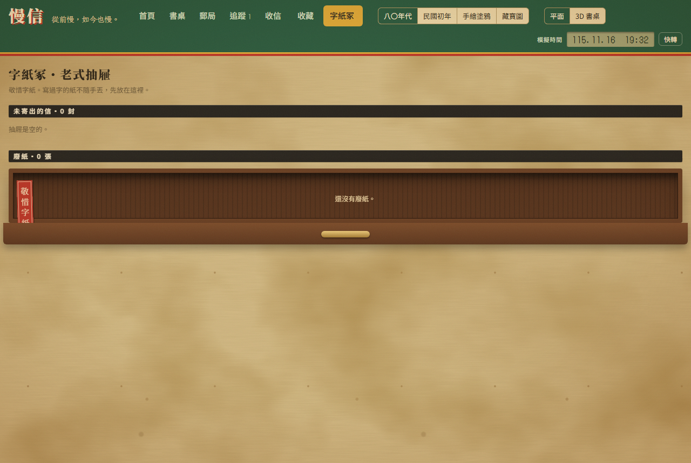 |
| 16 | 寄件人追蹤頁：已簽收 | 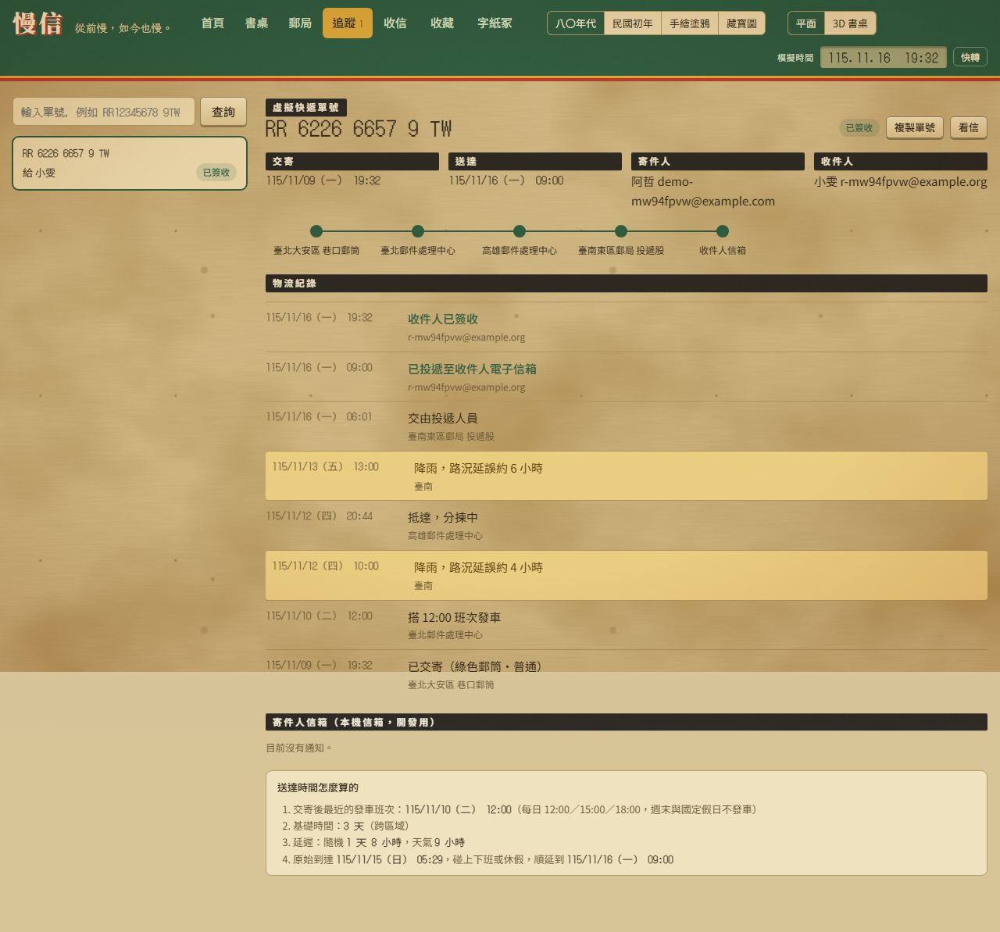 |
| 17 | 管理頁（正式版容器，只有數字與狀態） | 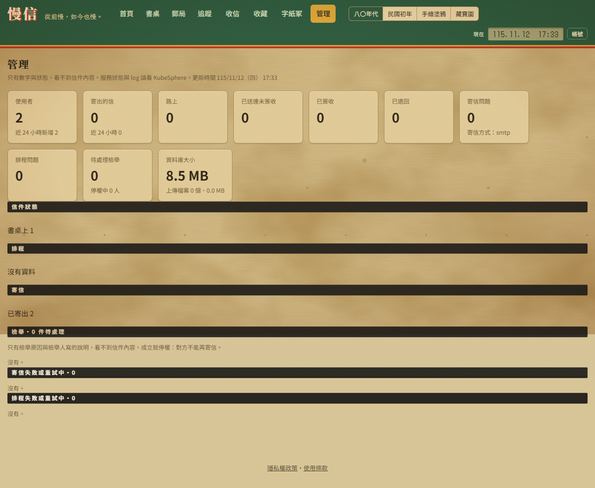 |
| 18 | 帳號設定（手機尺寸） |  |
| 19 | 民國風格收信頁 |  |

### 5.4 程式碼儲存連結

- GitHub：<https://github.com/toolmenj/manxin>
  - `main`：目前 GitHub 上的版本
  - `launch`：上線版（安全、防騷擾、部署設定），還在本機，尚未推上 GitHub
- 本機執行方式見 repo 的 `README.md`（`npm install` → `npm run dev:all:pglite`，不需要 Docker）；部署方式見 `deploy/README.md`。
